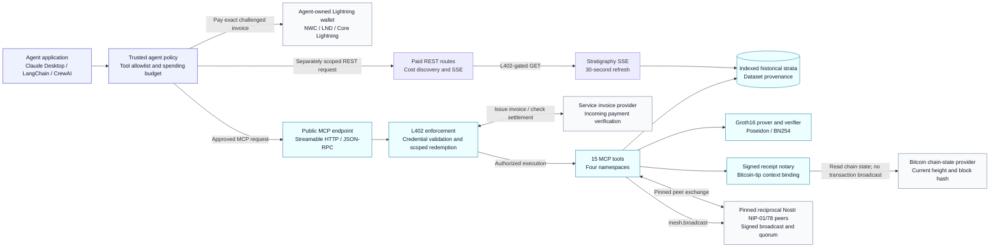
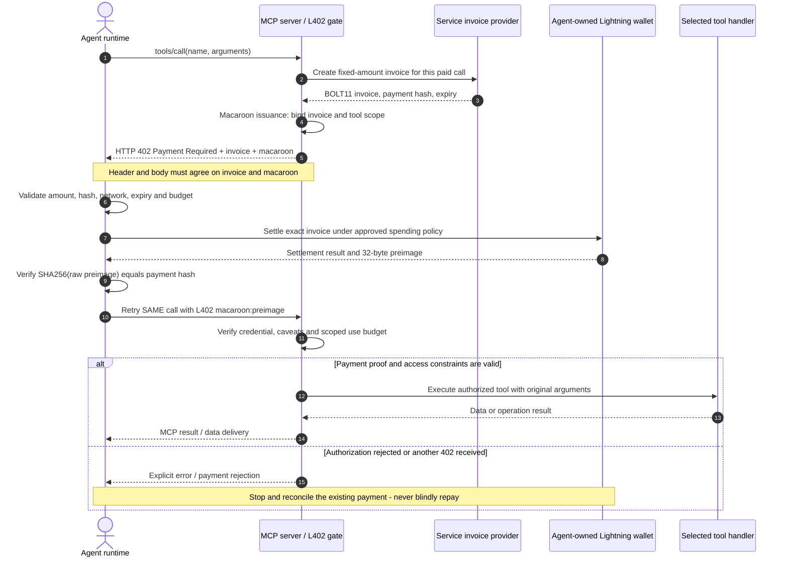
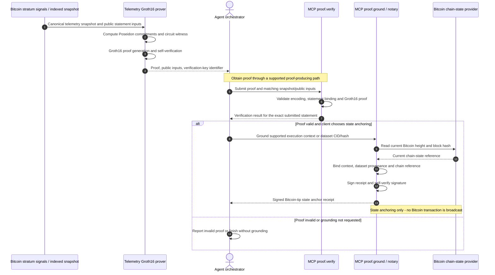

# Bitcoin Stratigraphy MCP Architecture

Mermaid sequence and system diagrams for agent developers integrating with
`https://bitcoinstratigraphy.com/mcp`.

The public interface uses stateless **Streamable HTTP**, supports MCP
**2026-07-28** (no initialize handshake or session; capabilities travel in each
request's `_meta`) alongside handshake-era **2025-11-25** clients, and
currently exposes **16 tools**. Discover the live catalog with `tools/list` and
query `payment.get_info` for current prices rather than relying on static
diagrams as a contract.

The service has distinct MCP and REST interfaces. MCP exposes the canonical
tool catalog; paid REST operations include price discovery and a separate
`GET /api/v1/stratigraphy/stream` Server-Sent Events (SSE) feed refreshed every
30 seconds. That stream is not an MCP transport. `/api/v1/cost` is authoritative
for current prices and settlement assets: the L402 router supports
`btc-lightning`, `l-btc`, and `taproot-assets` where enabled. MCP uses Lightning
L402; Base USDC x402 is conditional and MCP-only when explicitly available.
No Base USDC support is promised for the SSE route.

The seven overview capability areas are macaroon attenuation with TTL/request
controls; multi-asset settlement routing; Groth16/Poseidon BN254 telemetry and
drift verification plus separate OTS receipt verification; off-chain
Schnorr-signed Bitcoin-tip context/CID receipts; pinned reciprocal Nostr
NIP-01/78 peer broadcasts and quorum checks; indexed diffs/digests for efficient
context; and the separate paid SSE feed. These are capability groupings, not
seven additional MCP tools. Indexed historical heights are not live-tip data or
native per-record Bitcoin block provenance, and peer quorum is not source truth.

## Reading and interacting with the diagrams

- Open this document in a Mermaid-capable Markdown viewer, such as GitHub or a
  Markdown preview with Mermaid support. A plain-text viewer shows the source.
- Expand the **Implementation notes** panels for validation and trust details.
- In a renderer that permits Mermaid links, click a tool in the namespace map
  to open its Glama reference. Hover over a tool to see the link description.
  These links open documentation; they never execute tools or initiate payments.
- Node links, pan/zoom, and diagram export depend on the host viewer. GitHub
  and other security-restricted renderers may disable node links. The namespace
  table below provides ordinary Markdown links as a fallback.
- To inspect or adjust the diagrams outside this repository, paste an individual
  Mermaid code block into the [Mermaid Live Editor](https://mermaid.live/).
  Only share public diagram text, never credentials, challenges, or private data.

## 1. System overview and trust boundaries

**Boundary:** the agent's outgoing payer credentials and the service's incoming
invoice-provider credentials are separate. Tool output and model prompts must
never contain NWC secrets, wallet administrator credentials, macaroons, or
payment preimages. A model's proposed action is not spending authorization.

The overview groups dependencies by responsibility. It does not imply that
every tool invokes every dependency or that free discovery requires settlement.
The mesh is a reciprocal peer network; quorum is not authoritative telemetry
provenance or a substitute for validating the indexed source data.

## 2. L402 Micro-Payment Loop

**Flow:** agent tool call → HTTP 402 challenge → wallet invoice settlement →
macaroon-backed authorization → tool execution and data delivery.

**Issuance timing:** the server issues the unpaid, invoice-bound macaroon **with
the 402 challenge**, not after payment. Settlement supplies the missing payment
proof; the agent presents the original macaroon plus the verified preimage.
There is no separate post-payment macaroon-issuance endpoint in this loop.

<strong>Implementation notes: payment validation and failure handling</strong>

- Free discovery does not run this payment loop. Paid tools challenge before
  their protected execution.
- The challenge uses `WWW-Authenticate: L402 macaroon="…", invoice="…"`,
  with JSON fields including `macaroon`, `invoice`, `payment_hash`, and
  `amount_sats`. Parse the real response, not labels copied from a diagram.
- Before paying, validate the exact BOLT11 invoice, fixed amount, payment hash,
  intended network, expiry, allowed tool, and fee-inclusive spending budget.
- Reserve spending atomically and deduplicate concurrent payment attempts.
  NWC connection limits complement, but do not replace, application policy.
- Require the genuine 32-byte preimage and hash its raw bytes. A transaction ID
  or CoinOS internal-payment UUID is not a Lightning preimage.
- Retry the original JSON-RPC body and request ID once with the original
  macaroon. Do not treat MCP paid-call credentials as a reusable subscription
  or as permission to run another tool. REST subscription credentials have
  distinct REST scopes and cannot be transferred to MCP calls or other routes.
- A payment timeout is ambiguous. Reconcile the original payment hash before
  considering another attempt; never infer non-payment from a network error.
- HTTP success does not guarantee tool success: inspect JSON-RPC errors and
  MCP `isError`. A valid payment does not guarantee available data, peers, or
  a successful tool result.
- Standard Claude Desktop bridges and Python MCP clients do not auto-pay.
  Automatic settlement requires a separately configured, opt-in payer.

See [L402 Agent Payments](L402_AGENT_PAYMENTS.md) for wallet configuration,
budgets, reconciliation, and the existing client integration.

## 3. ZK-SNARK and Stratum Notary Pipeline

**Flow:** Bitcoin stratum signals → Groth16 proof generation →
`proof.verify` → optional `proof.ground` state anchoring.

This is an **agent-orchestrated workflow**, not a claim that `proof.verify`
automatically invokes `proof.ground`. Each paid tool call requires its own
authorization. The client decides whether verified material should be included
in a grounding request.

<strong>Implementation notes: what the proof and anchor establish</strong>

- The telemetry proof uses **Groth16/Poseidon BN254**. Its public statement
  includes `blockHeight`, `thermodynamicHash`, `timestamp`, `valuationSat`,
  and `snapshotDigest`. Verification must bind the exact proof, public inputs,
  verification key, and associated snapshot.
- There is no advertised `proof.generate` MCP tool. Generation is an internal
  service capability used by supported proof-producing paths. Inspect the
  actual response and published schemas; do not invent a generation tool or
  assume every `stratigraphy.*` response contains a proof.
- `proof.verify` supports Groth16/Poseidon BN254 telemetry verification,
  separate drift-proof verification, and a distinct OpenTimestamps receipt
  verification mode. The diagram focuses on the telemetry Groth16 path, not
  every verifier mode.
- `proof.ground` accepts its published context or dataset-identifier input
  variants. It does not accept arbitrary Groth16 coordinates as an invented
  anchoring API, nor does it enforce that `proof.verify` was called first.
- The `proof.ground` result is an **off-chain Schnorr-signed Bitcoin-tip
  context/CID receipt**.
  It binds execution context or dataset identity and provenance to observed
  chain state. It is not itself a Groth16 proof, a Bitcoin proof-of-work
  validity proof, or a newly mined on-chain commitment.
- If the client wants the receipt to refer to a verified proof, bind its exact
  identifier/digest through the supported context or metadata fields and
  independently check that relationship. A signature over caller-supplied
  metadata does not automatically validate that metadata's claim.
- On-chain anchoring needs a separate, explicit publication and confirmation
  workflow. `proof.ground` alone does not submit a Bitcoin transaction.
  OpenTimestamps verification is a separate path and requires a real receipt.
- Historical strata use a documented deterministic daily block index; do not
  confuse an indexed stratum height with the live tip read by the notary.
- Retain original proof and receipt payloads. A lifecycle/status index is not
  a complete archive and cannot substitute for cryptographic verification.

## 4. Complete MCP namespace map

The endpoint exposes **5 stratigraphy + 7 proof + 2 mesh + 1 payment + 1 workflow = 16 tools**.
Tool nodes link to public reference pages in Mermaid renderers that allow links.
Names are canonical, case-sensitive MCP names, not Python method names.

```mermaid
flowchart TB
    Agent["MCP agent client"]
    MCP["Streamable HTTP /mcp<br/>Discovery, validation and paid-call gate"]
    Agent --> MCP

    subgraph Stratigraphy["stratigraphy.* · 5 tools"]
        direction TB
        s_list["stratigraphy.list<br/>Dataset bounds and metrics"]
        s_get["stratigraphy.get<br/>Indexed telemetry records"]
        s_digest["stratigraphy.get_digest<br/>Compact telemetry summary"]
        s_diff["stratigraphy.get_diff<br/>Differences between strata"]
        s_range["stratigraphy.get_range<br/>Bounded compressed records"]
    end

    subgraph Proof["proof.* · 7 tools"]
        direction TB
        p_attenuate["proof.attenuate<br/>Restrict a delegated macaroon"]
        p_verify["proof.verify<br/>Groth16 or OTS verification"]
        p_get["proof.get_by_hash<br/>Retained proof / receipt lookup"]
        p_list["proof.list<br/>Indexed attestation catalog"]
        p_submit["proof.submit<br/>Proof registration and attestation"]
        p_notarize["proof.notarize<br/>OpenTimestamps receipt for a digest"]
        p_ground["proof.ground<br/>Signed Bitcoin-tip state receipt"]
    end

    subgraph Mesh["mesh.* · 2 tools"]
        direction TB
        m_status["mesh.get_status<br/>Peer and quorum health"]
        m_broadcast["mesh.broadcast<br/>Sign and distribute a stored snapshot"]
    end

    subgraph Payment["payment.* · 1 tool"]
        direction TB
        pay_info["payment.get_info<br/>Query prices / verify or settle payment"]
    end

    MCP --> Stratigraphy
    MCP --> Proof
    MCP --> Mesh
    MCP --> Payment

    classDef discovery fill:#f0fdf4,stroke:#15803d,color:#111827;
    classDef paid fill:#fff7ed,stroke:#c2410c,color:#111827;
    classDef credential fill:#eef2ff,stroke:#4338ca,color:#111827;
    class s_list,p_list discovery;
    class s_get,s_digest,s_diff,s_range,p_verify,p_get,p_submit,p_notarize,p_ground,m_status,m_broadcast,pay_info paid;
    class p_attenuate credential;

    click s_list href "https://glama.ai/mcp/connectors/app.replit.bitcoin-stratigraphy-dashboard--charlesstrogish/bitcoin-stratigraphy/tools/stratigraphy.list" "Dataset discovery reference" _blank
    click s_get href "https://glama.ai/mcp/connectors/app.replit.bitcoin-stratigraphy-dashboard--charlesstrogish/bitcoin-stratigraphy/tools/stratigraphy.get" "Indexed telemetry reference" _blank
    click s_digest href "https://glama.ai/mcp/connectors/app.replit.bitcoin-stratigraphy-dashboard--charlesstrogish/bitcoin-stratigraphy/tools/stratigraphy.get_digest" "Compact digest reference" _blank
    click s_diff href "https://glama.ai/mcp/connectors/app.replit.bitcoin-stratigraphy-dashboard--charlesstrogish/bitcoin-stratigraphy/tools/stratigraphy.get_diff" "Stratum comparison reference" _blank
    click s_range href "https://glama.ai/mcp/connectors/app.replit.bitcoin-stratigraphy-dashboard--charlesstrogish/bitcoin-stratigraphy/tools/stratigraphy.get_range" "Bounded range reference" _blank
    click p_attenuate href "https://glama.ai/mcp/connectors/app.replit.bitcoin-stratigraphy-dashboard--charlesstrogish/bitcoin-stratigraphy/tools/proof.attenuate" "Macaroon attenuation reference" _blank
    click p_verify href "https://glama.ai/mcp/connectors/app.replit.bitcoin-stratigraphy-dashboard--charlesstrogish/bitcoin-stratigraphy/tools/proof.verify" "Proof verification reference" _blank
    click p_get href "https://glama.ai/mcp/connectors/app.replit.bitcoin-stratigraphy-dashboard--charlesstrogish/bitcoin-stratigraphy/tools/proof.get_by_hash" "Proof and receipt lookup reference" _blank
    click p_list href "https://glama.ai/mcp/connectors/app.replit.bitcoin-stratigraphy-dashboard--charlesstrogish/bitcoin-stratigraphy/tools/proof.list" "Attestation catalog reference" _blank
    click p_submit href "https://glama.ai/mcp/connectors/app.replit.bitcoin-stratigraphy-dashboard--charlesstrogish/bitcoin-stratigraphy/tools/proof.submit" "Proof registration reference" _blank
    click p_ground href "https://glama.ai/mcp/connectors/app.replit.bitcoin-stratigraphy-dashboard--charlesstrogish/bitcoin-stratigraphy/tools/proof.ground" "Signed state anchor reference" _blank
    click m_status href "https://glama.ai/mcp/connectors/app.replit.bitcoin-stratigraphy-dashboard--charlesstrogish/bitcoin-stratigraphy/tools/mesh.get_status" "Mesh status reference" _blank
    click m_broadcast href "https://glama.ai/mcp/connectors/app.replit.bitcoin-stratigraphy-dashboard--charlesstrogish/bitcoin-stratigraphy/tools/mesh.broadcast" "Outbound snapshot broadcast reference" _blank
    click pay_info href "https://glama.ai/mcp/connectors/app.replit.bitcoin-stratigraphy-dashboard--charlesstrogish/bitcoin-stratigraphy/tools/payment.get_info" "Live pricing and payment reference" _blank
```

**Legend:** green = free discovery/query operations; orange = paid execution;
indigo = credential attenuation. Colors describe the documented categories,
not blanket authorization. Only `stratigraphy.list` and `proof.list` are free;
`payment.get_info` and `proof.attenuate` are L402-paid calls, and attenuation
also requires a valid parent credential and enforced caveats.
Always check current payment availability and prices at runtime.

### Namespace reference and link fallback

| Namespace | Tools | Responsibilities and boundaries |
| --- | --- | --- |
| `stratigraphy.*` | `list`, `get`, `get_digest`, `get_diff`, `get_range` | Read indexed historical data. No advertised ingest, update, or delete tool. |
| `proof.*` | `attenuate`, `verify`, `get_by_hash`, `list`, `submit`, `ground` | Verify/register proofs, retrieve retained payloads, constrain credentials, and issue signed state receipts. Grounding is not on-chain transaction submission. |
| `mesh.*` | `get_status`, `broadcast` | Inspect pinned reciprocal Nostr peer/quorum health and broadcast stored snapshots. Quorum is not source truth. No inbound peer-administration or subscription tool is advertised. |
| `payment.*` | `get_info` | Discover payment terms or use the authenticated settlement mode. Price queries do not create invoices or authorize spending. |

All tool-reference links are also available from the
[Glama tool catalog](https://glama.ai/mcp/connectors/app.replit.bitcoin-stratigraphy-dashboard--charlesstrogish/bitcoin-stratigraphy)
and [public MCP server card](https://bitcoinstratigraphy.com/.well-known/mcp/server-card.json).
The definitive callable schemas come from the live MCP `tools/list` response,
not from these diagrams or a cached registry page.

## Integration guides and implementation references

- [Claude Desktop setup](CLAUDE_DESKTOP_SETUP.md)
- [LangChain and CrewAI Python integration](LANGCHAIN_CREWAI_GUIDE.md)
- [Agent-owned L402 payments](L402_AGENT_PAYMENTS.md)
- [Connection guide and 14-tool catalog](../CONNECT.md)
- [MCP routing and tool implementation](../artifacts/api-server/src/routes/mcp.ts)
- [Groth16 telemetry proof service](../artifacts/api-server/src/services/zkProofService.ts)
- [Mermaid sequence diagram syntax](https://mermaid.js.org/syntax/sequenceDiagram.html)
- [Mermaid flowcharts and node links](https://mermaid.js.org/syntax/flowchart.html)

These diagrams document existing behavior. They add no server handlers, tool
definitions, OpenAPI schemas, wallet configuration, or deployment settings.